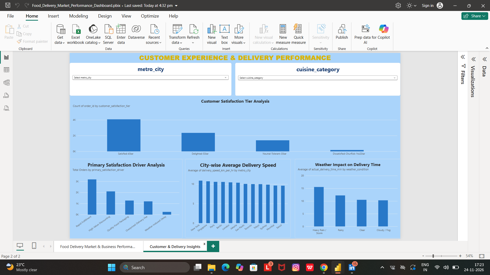

Food Delivery Market & Business Performance Dashboard

Project Overview
An interactive Power BI dashboard designed to analyze food delivery market performance, customer experience, revenue, and delivery operations.

Tools Used
- Microsoft Power BI
- Power Query
- DAX
- Excel

 Dashboard Pages

 Page 1: Business Performance
- Total Orders
- Total Revenue
- Net Customer Spending
- Average Order Value
- Average Rating
- Estimated Profit Margin
- City-wise Order Distribution
- Cuisine-wise Revenue Analysis

Page 2: Customer & Delivery Insights
- Customer Satisfaction Analysis
- Primary Satisfaction Drivers
- Weather Impact on Delivery Time
- City-wise Delivery Speed

Key Features
- Interactive City and Cuisine slicers
- KPI Cards
- Data visualization
- Blue & White corporate theme

Project File
`Food_Delivery_Market_Performance_Dashboard.pbix`

Author
Harshit Srivastava
Aspiring Data Analyst | Excel | Power BI | SQL
## Dashboard Preview

### Page 2 – Customer & Delivery Insights

## Key Analysis Areas

1. **Order Performance:** Analysis of total orders across metro cities and order channels.
2. **Revenue Analysis:** Comparison of revenue generated by different cuisine categories.
3. **Customer Experience:** Analysis of customer satisfaction tiers and their primary satisfaction drivers.
4. **Delivery Performance:** Evaluation of delivery time under different weather conditions.
5. **City-wise Delivery Speed:** Comparison of average delivery speed across metro cities.
6. **Business Profitability:** Analysis of estimated restaurant net margins and customer spending.

## Business Objectives

- Understand food delivery market performance.
- Identify revenue-generating cuisine categories.
- Evaluate customer satisfaction patterns.
- Analyze delivery efficiency.
- Support data-driven business decisions.
